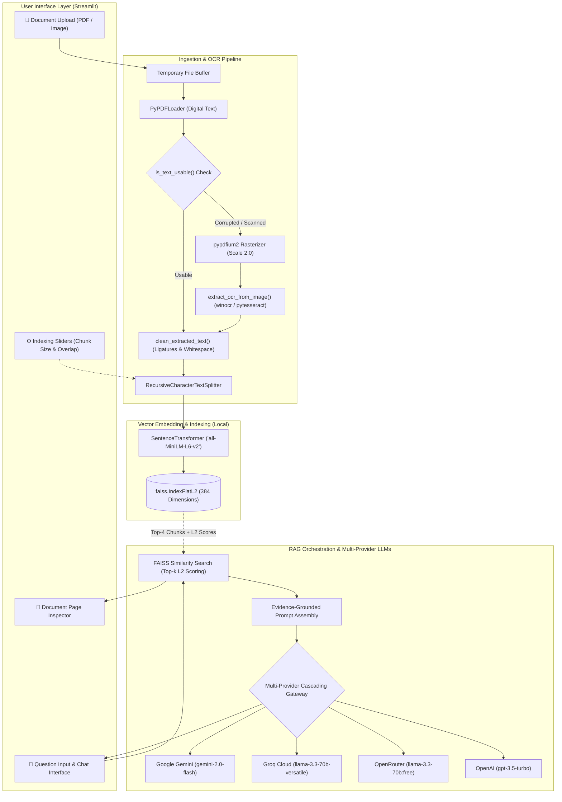

# 🧠 DocuMind AI

### *High-Performance, Verifiable Retrieval-Augmented Generation (RAG) Document Assistant*

[](https://www.python.org/)
[](https://streamlit.io/)
[](https://github.com/facebookresearch/faiss)
[](https://huggingface.co/sentence-transformers/all-MiniLM-L6-v2)
[](LICENSE)
[](tests/)

---

## 📖 Table of Contents
- [Overview](#-overview)
- [Key Features](#-key-features)
- [System Architecture](#-system-architecture)
- [Technology Stack](#-technology-stack)
- [Quickstart Guide](#-quickstart-guide)
- [Configuration & Environment Variables](#-configuration--environment-variables)
- [Docker Deployment](#-docker-deployment)
- [Project Structure](#-project-structure)
- [Deep Technical Documentation](#-deep-technical-documentation)
- [Testing & Quality Assurance](#-testing--quality-assurance)
- [Security & Privacy Considerations](#-security--privacy-considerations)
- [Limitations & Future Scope](#-limitations--future-scope)
- [License](#-license)

---

## 🌟 Overview

**DocuMind AI** is an open-source, production-oriented document intelligence platform powered by **Retrieval-Augmented Generation (RAG)**. It transforms unstructured multi-page PDFs and raster images into a conversational knowledge base that answers natural language inquiries with grounded citations and page numbers.

Standard keyword search (Ctrl+F, BM25) fails when users ask questions requiring semantic abstraction, while standalone Large Language Models (LLMs) hallucinate facts and lack access to private, internal documents. DocuMind AI bridges this gap:
1. It ingests documents locally, repairs typography, and automatically applies **Optical Character Recognition (OCR)** on scanned or degraded pages.
2. It segments text into boundary-aware chunks and computes 384-dimensional dense semantic vectors using a local **Sentence Transformer** (`all-MiniLM-L6-v2`).
3. It performs sub-millisecond similarity retrieval via an in-memory **FAISS FlatL2** vector store.
4. It prompts unified multi-provider LLMs (**Google Gemini 2.0 Flash**, **Groq Llama 3.3 70B**, **OpenRouter**, or **OpenAI**) with strict anti-hallucination guardrails and automated cascading.
5. It empowers users to **visually verify citations** by rendering original page image previews directly inside the web interface.

---

## ⚡ Key Features

- 📄 **Multi-Format Ingestion**: Supports digital PDFs, scanned documents, and image formats (`.png`, `.jpg`, `.jpeg`, `.webp`, `.bmp`).
- 🔍 **Multi-Engine Extraction with OCR Fallback**: Combines `pypdf` with `pypdfium2` and an automated text usability heuristic (`is_text_usable()`). Pages with fewer than 30 characters or corrupted CID font glyphs automatically route to native Windows OCR (`winocr`) or cross-platform `pytesseract`.
- 🧹 **Typographic Normalization**: Automatically expands ligatures (`fi` $\rightarrow$ `fi`, `fl` $\rightarrow$ `fl`, etc.), strips null bytes, cleans non-printable artifacts, and standardizes spacing.
- ⚙️ **Parameterized Semantic Chunking**: Real-time slider adjustment for chunk size (100–2,000 characters) and chunk overlap (0–500 characters) via `RecursiveCharacterTextSplitter`.
- ⚡ **Local Dense Embeddings & FAISS Indexing**: Embeddings run 100% locally on CPU/GPU via `all-MiniLM-L6-v2` with an exact Euclidean distance ($L_2$) FAISS index, eliminating embedding API expenses.
- 🔑 **Multi-Provider Free LLM Access**: Integrated support for completely free AI models through Google Gemini (2.0 Flash) and Groq (Llama 3.3 70B) alongside OpenRouter and OpenAI.
- 🛡️ **Fault-Tolerant Model Cascading**: Automatically cascades through fallback candidate models when transient HTTP 503 (high demand), 429 (rate limits), or 404 errors occur.
- 📖 **Interactive Document Inspection**: Select any indexed document and page slider to render high-resolution raster images of the original document page at 1.8x scale.
- 📊 **Transparent Distance Telemetry**: Displays exact mathematical $L_2$ Euclidean distance scores and extraction badges ("🔍 OCR Enhanced" vs "⚡ Native Text") for all retrieved passages.
- 🔒 **In-Memory Privacy Architecture**: Uploaded PDF files are unlinked from disk immediately after vectorization; embeddings and previews exist solely within session memory.

---

## 🏗️ System Architecture



---

## 🛠️ Technology Stack

| Layer | Technology | Version / Specification | Rationale |
| :--- | :--- | :--- | :--- |
| **Frontend UI** | [Streamlit](https://streamlit.io/) | `^1.37.0` | Reactive web interface with real-time session state management. |
| **Vector Index** | [FAISS CPU](https://github.com/facebookresearch/faiss) | `^1.7.4` | High-performance in-memory exact Euclidean ($L_2$) distance nearest-neighbor search. |
| **Embeddings** | [Sentence Transformers](https://www.sbert.net/) | `all-MiniLM-L6-v2` | Dense 384-dimensional embeddings computed locally without external API latency or costs. |
| **Document Ingestion** | [PyPDF](https://pypdf.readthedocs.io/) & [pypdfium2](https://pypdfium2.readthedocs.io/) | `pypdf>=3.17.0`, `pypdfium2>=4.30.0` | High-fidelity PDF digital extraction, fallback parsing, and high-DPI page rasterization. |
| **OCR Engines** | `winocr` & `pytesseract` | `winocr>=0.0.15`, `Pillow>=10.0.0` | Native Windows Media OCR for speed on Windows; Tesseract for cross-platform fallback. |
| **RAG & Prompts** | [LangChain](https://www.langchain.com/) | `langchain>=0.2.5`, `langchain-openai>=0.0.2` | Structured document schemas, text splitting, and OpenAI-compatible client abstractions. |
| **LLM Gateway** | Google Gemini, Groq, OpenRouter, OpenAI | Multi-Provider REST | Access to state-of-the-art free and commercial LLMs with automatic cascading retries. |
| **Containerization** | [Docker](https://www.docker.com/) | Debian `python:3.11-slim` | Multi-stage, CPU-optimized container with dynamic dependency filtering and health checks. |
| **Testing** | [pytest](https://pytest.org/) | `pytest>=7.4.4`, `pytest-mock` | Automated test suite (19 unit/integration tests) verifying all pipeline modules. |

---

## 🚀 Quickstart Guide

### Prerequisites
- Python `3.10` or `3.11`
- Git installed on your system
- At least one free API key from [Google AI Studio](https://aistudio.google.com/app/apikey) or [Groq Console](https://console.groq.com/keys)

### 1. Clone the Repository
```bash
git clone https://github.com/sarthak-takle/DocuMind_ai.git
cd DocuMind_ai
```

### 2. Set Up a Virtual Environment
**On Windows (PowerShell):**
```powershell
python -m venv venv
.\venv\Scripts\Activate.ps1
```

**On Linux / macOS:**
```bash
python3 -m venv venv
source venv/bin/activate
```

### 3. Install Dependencies
```bash
python -m pip install --upgrade pip
pip install -r requirements.txt
```

### 4. Configure Environment Variables (Optional)
```bash
# On Linux/macOS:
cp .env.example .env

# On Windows PowerShell:
Copy-Item .env.example .env
```
*(You can also paste API keys directly into the sidebar password field in the web UI).*

### 5. Launch the Application
```bash
streamlit run app.py
```
Open your browser at `http://localhost:8501`.

---

## ⚙️ Configuration & Environment Variables

| Variable Name | Required | Provider / Default | Description |
| :--- | :--- | :--- | :--- |
| `GEMINI_API_KEY` | Optional* | Google Gemini (Free) | Free key from [Google AI Studio](https://aistudio.google.com/app/apikey). |
| `GROQ_API_KEY` | Optional* | Groq (Free) | Free key from [Groq Console](https://console.groq.com/keys) for Llama 3.3 70B. |
| `OPENROUTER_API_KEY` | Optional* | OpenRouter (Free Tier) | Key from [OpenRouter](https://openrouter.ai/keys) for open community models. |
| `OPENAI_API_KEY` | Optional* | OpenAI | Paid key from [OpenAI Platform](https://platform.openai.com/api-keys). |
| `CHUNK_SIZE` | Configurable | `1000` | Target character length for document segments (adjustable via UI). |
| `CHUNK_OVERLAP` | Configurable | `200` | Overlapping characters between adjacent segments to preserve context. |

*\*At least one provider key is required to synthesize answers; keys can be supplied via `.env` or input directly in the UI.*

---

## 🐳 Docker Deployment

The application includes a production-ready, CPU-optimized [`Dockerfile`](Dockerfile) that strips GPU dependencies to keep the image lightweight.

### 1. Build the Docker Image
```bash
docker build -t documind-ai:latest .
```

### 2. Run Container Locally
```bash
docker run -d \
  --name documind-app \
  -p 8501:8501 \
  --env-file .env \
  documind-ai:latest
```

### 3. Verify Container Status & Logs
```bash
docker ps
docker logs -f documind-app
```
Access the application at `http://localhost:8501`.

---

## 📂 Project Structure

```bash
DocuMind_ai/
├── app.py                      # Streamlit frontend, state management & UI styling
├── document_processor.py       # Multi-engine document parser, OCR fallback & text chunker
├── vector_store.py             # SentenceTransformers embeddings & FAISS index
├── rag.py                      # RAG pipeline, anti-hallucination prompts & LLM cascading
├── conftest.py                 # Pytest test configuration & shared fixtures
├── create_sample.py            # Utility script to generate test PDFs with ReportLab
├── requirements.txt            # Production dependencies
├── requirements-dev.txt        # Development, testing, and linting dependencies
├── setup.py                    # Package distribution metadata
├── Dockerfile                  # Production CPU-optimized Dockerfile
├── .dockerignore               # Files excluded from Docker builds
├── .env.example                # Template for environment keys
├── .github/workflows/          # CI/CD automated test workflow
│   └── python-tests.yml
├── docs/                       # Comprehensive technical documentation
│   ├── PROJECT_DESCRIPTION.md  # Detailed system overview and feature analysis
│   ├── ARCHITECTURE.md         # Architecture diagrams and component interactions
│   ├── TECHNICAL_WORKFLOW.md   # Execution flow, RAG internals, and OCR pipeline
│   ├── DEPLOYMENT.md           # Docker instructions, security, and test verification
│   └── INTERVIEW_PREPARATION.md# Resume bullets, presentation outline & 20 viva Q&As
└── tests/                      # Automated unit and integration test suite
    ├── test_app.py
    ├── test_document_processor.py
    ├── test_rag.py
    └── test_vector_store.py
```

---

## 📚 Deep Technical Documentation

Detailed technical documents are available in the [`docs/`](docs/) directory:

- 📘 [**Project Description & Problem Statement**](docs/PROJECT_DESCRIPTION.md): Full analysis of document search challenges, system goals, core features, and technical trade-offs.
- 🏗️ [**System Architecture & Topology**](docs/ARCHITECTURE.md): Layer-by-layer architectural decomposition, component interaction diagrams, and local vs. cloud data flows.
- 🔬 [**Technical Workflow & RAG Internals**](docs/TECHNICAL_WORKFLOW.md): Step-by-step 15-stage execution trace, vector mathematics ($L_2$ distance vs. Cosine Similarity), OCR heuristic mechanics, and module-by-module breakdown.
- 🚀 [**Deployment, Docker & Security Guide**](docs/DEPLOYMENT.md): Container build steps, Linux vs. Windows OCR considerations, threat boundaries, and error handling.
- 🎓 [**Interview, Viva & Presentation Guide**](docs/INTERVIEW_PREPARATION.md): Resume bullets, elevator pitches, a 5-minute technical presentation outline, 20 viva Q&As, and 5 challenging architecture trade-off analyses.

---

## 🧪 Testing & Quality Assurance

The codebase includes an automated test suite verifying all core modules:

```bash
# Run all unit and integration tests
pytest

# Run tests with verbose output
pytest -v

# Run with test coverage report
pytest --cov=. --cov-report=term-missing
```

### Verified Test Results (19 / 19 Passing)
```text
tests/test_app.py                  ..                                    [ 10%]
tests/test_document_processor.py   .....                                 [ 36%]
tests/test_rag.py                  ....                                  [ 57%]
tests/test_vector_store.py         ........                              [100%]
============================== 19 passed in 9.10s ===============================
```

---

## 🔒 Security & Privacy Considerations

- **In-Memory Volatility**: Document chunks and vector embeddings reside strictly within volatile RAM during the active session. When the server process ends or the session resets, all indexed data is purged.
- **Immediate Disk Cleanup**: Uploaded files written to temporary directories for parsing are unlinked immediately after chunking via `os.unlink()`.
- **Credential Protection**: API keys in `.env` are excluded from version control and Docker images via `.gitignore` and `.dockerignore`.
- **Confidentiality Scope**: Raw document files are never transmitted across the network. Only the final assembled prompt containing the user question and the top-$k$ retrieved excerpts is sent to the selected LLM provider over TLS 1.3 HTTPS.

---

## 🗺️ Limitations & Future Scope

| Dimension | Current Implementation | Planned Future Enhancement |
| :--- | :--- | :--- |
| **Persistence** | In-memory `st.session_state` FAISS index. | Disk serialization for pre-built indices via persistent vector stores (ChromaDB/SQLite). |
| **Search Paradigm** | Dense semantic vector similarity ($L_2$). | Hybrid Search combining BM25 sparse keyword matching with dense vectors via Reciprocal Rank Fusion (RRF). |
| **Reranking** | Top-$k$ selection directly from FAISS. | Cross-Encoder reranking (e.g., `bge-reranker-large`) to improve precision on large corpora. |
| **Visual Citations** | Full-page raster image rendered via `pypdfium2`. | Extracting PDF coordinate bounding boxes to visually highlight cited sentences on the page canvas. |
| **Multi-Tenancy** | Single-node session-isolated Streamlit server. | User authentication (OAuth2/JWT) and multi-tenant database isolation. |

---

## 📄 License

Distributed under the **MIT License**. See [`LICENSE`](LICENSE) for full details.
