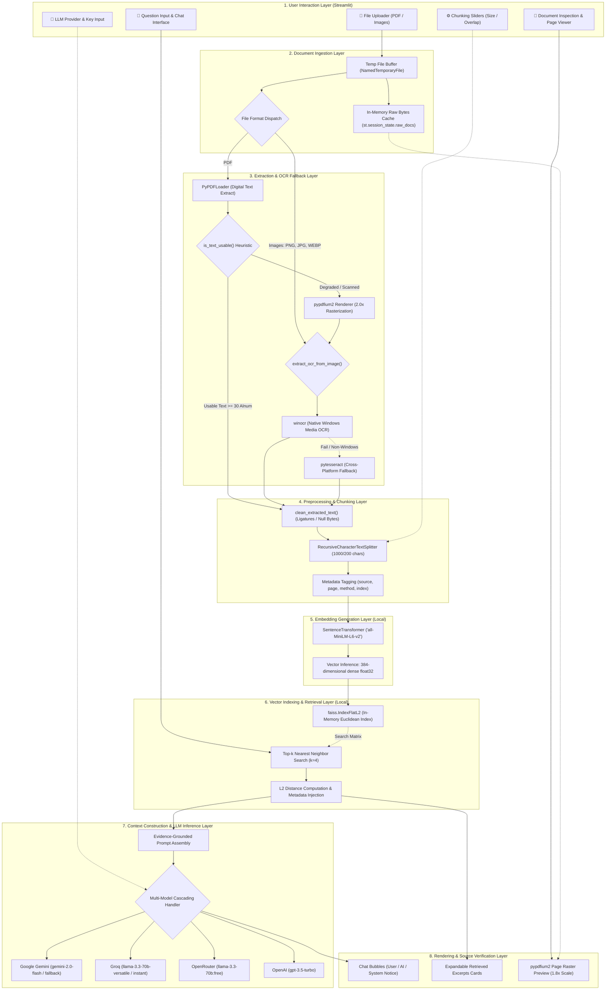
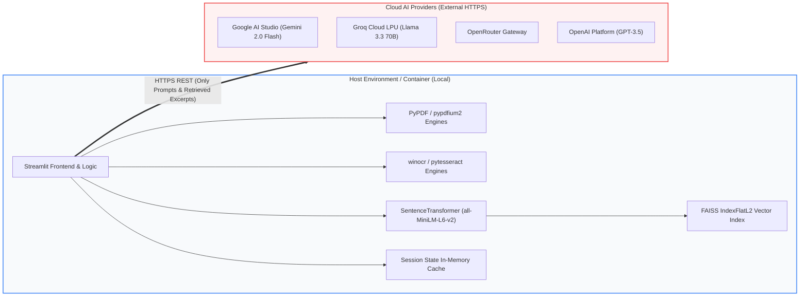

# DocuMind AI: System Architecture & Component Interactions

> **Module Reference**: Architectural Specification & Topology  
> **Source Files**: [`app.py`](file:///c:/Users/Mahan/Downloads/DocuMind_ai-main/DocuMind_ai-main/app.py), [`document_processor.py`](file:///c:/Users/Mahan/Downloads/DocuMind_ai-main/DocuMind_ai-main/document_processor.py), [`vector_store.py`](file:///c:/Users/Mahan/Downloads/DocuMind_ai-main/DocuMind_ai-main/vector_store.py), [`rag.py`](file:///c:/Users/Mahan/Downloads/DocuMind_ai-main/DocuMind_ai-main/rag.py)  

---

## 1. Architectural Overview

DocuMind AI is architected as an end-to-end, decoupled **Retrieval-Augmented Generation (RAG)** pipeline optimized for low-latency in-memory computation, zero local persistence of sensitive data, and fault-tolerant cloud LLM invocation.

The architecture separates responsibilities into eight functional layers:



---

## 2. Layer-by-Layer Architectural Decomposition

### 2.1 User Interaction Layer (Streamlit)
- **Component File**: [`app.py`](file:///c:/Users/Mahan/Downloads/DocuMind_ai-main/DocuMind_ai-main/app.py)
- **Role**: Provides a reactive, responsive, wide-screen browser interface.
- **Responsibilities**:
  - Encapsulates state within `st.session_state`:
    - `st.session_state.vector_store`: Singleton [`VectorStore`](file:///c:/Users/Mahan/Downloads/DocuMind_ai-main/DocuMind_ai-main/vector_store.py#L8) instance.
    - `st.session_state.processor`: Singleton [`DocumentProcessor`](file:///c:/Users/Mahan/Downloads/DocuMind_ai-main/DocuMind_ai-main/document_processor.py#L90) instance.
    - `st.session_state.rag`: Singleton [`RAG`](file:///c:/Users/Mahan/Downloads/DocuMind_ai-main/DocuMind_ai-main/rag.py#L45) controller.
    - `st.session_state.raw_docs`: Dictionary mapping document filenames to raw binary buffers (`bytes`).
    - `st.session_state.uploaded_files`: Telemetry list storing document metrics (file size, total chunks, OCR chunk counts).
    - `st.session_state.chat_history`: Multi-turn conversational log.
  - Implements custom CSS formatting: dark-slate container palette (`#0f172a`, `#1e293b`), emerald verification bubbles, and crimson error banners.

### 2.2 Document Ingestion Layer
- **Component Files**: [`app.py:process_document`](file:///c:/Users/Mahan/Downloads/DocuMind_ai-main/DocuMind_ai-main/app.py#L189-L225), [`document_processor.py:process_document`](file:///c:/Users/Mahan/Downloads/DocuMind_ai-main/DocuMind_ai-main/document_processor.py#L267-L282)
- **Role**: Secure reception, format validation, and temporary disk staging.
- **Data Flow**:
  1. The browser uploads raw binary data via `st.file_uploader`.
  2. A temporary file is instantiated via `tempfile.NamedTemporaryFile(delete=False, suffix=ext)`.
  3. Raw bytes are simultaneously recorded into `st.session_state.raw_docs[filename]`.
  4. The file extension is inspected (`ext in ['.png', '.jpg', '.jpeg', '.bmp', '.tiff', '.webp']` vs `.pdf`).
  5. The temporary file on disk is strictly unlinked in a `finally:` block (`os.unlink(tmp_path)`), ensuring zero residual data remains on the host filesystem.

### 2.3 Extraction & OCR Fallback Layer
- **Component File**: [`document_processor.py`](file:///c:/Users/Mahan/Downloads/DocuMind_ai-main/DocuMind_ai-main/document_processor.py)
- **Role**: Converts heterogeneous binary files into structured text documents with complete provenance metadata.
- **Sub-Components**:
  - `PyPDFLoader`: High-speed stream extraction for native digital PDFs.
  - `is_text_usable(text, min_alphanumeric=30)`:
    - Counts alphanumeric characters. If $< 30$, treats page as scanned or blank.
    - RegEx inspects font mapping glyph codes: if `re.findall(r'\(cid:\d+\)', text)` exceeds 5 matches and represents $> 30\%$ of total tokens, flags text as corrupted.
  - `pypdfium2` Rendering Pipeline: If native text is unusable, `pypdfium2.PdfDocument` renders the individual page to a high-resolution PIL image at `scale=2.0`.
  - `extract_ocr_from_image(image)`:
    - Engine 1 (`winocr`): Windows.Media.Ocr native runtime binding. Fast, hardware-accelerated, zero binary installation required.
    - Engine 2 (`pytesseract`): Cross-platform wrapper calling the Google Tesseract-OCR binary.
  - Fail-Safe Output: If both native extraction and OCR yield zero text, the page is tagged with `"(No readable text detected on this page)"` and marked `native_unclear`, preventing pipeline crashes.

### 2.4 Preprocessing & Chunking Layer
- **Component File**: [`document_processor.py`](file:///c:/Users/Mahan/Downloads/DocuMind_ai-main/DocuMind_ai-main/document_processor.py#L9-L42,L249-L265)
- **Role**: Cleans extracted text and partitions it into uniform semantic chunks.
- **Normalization Pipeline**:
  - Strips null bytes (`\x00`) and the Unicode replacement character (`\uFFFD`).
  - Restores ligatures: `fi` $\rightarrow$ `fi`, `fl` $\rightarrow$ `fl`, `ff` $\rightarrow$ `ff`, `ffi` $\rightarrow$ `ffi`, `ffl` $\rightarrow$ `ffl`.
  - Normalizes quotation marks and dashes: `’` / `‘` $\rightarrow$ `'`, `“` / `”` $\rightarrow$ `"`, `–` / `—` $\rightarrow$ `-`.
  - Normalizes non-breaking whitespace (`\xa0` $\rightarrow$ `' '`) and removes zero-width spaces (`\u200b`).
  - Standardizes line breaks (`\r\n` $\rightarrow$ `\n`), collapses triple newlines to double, and compresses multiple horizontal spaces.
- **Recursive Splitting**:
  - `RecursiveCharacterTextSplitter` iteratively partitions text across prioritized boundary delimiters: paragraph breaks (`\n\n`), line breaks (`\n`), sentence endings (`. `, `? `, `! `, `; `), and words (` `).
  - Every resulting chunk is stamped with metadata:
    ```python
    {
        "source": "sample.pdf",
        "page": 1,
        "extraction_method": "native" | "pdfium" | "ocr" | "native_unclear",
        "ocr_applied": True | False,
        "char_count": 984,
        "chunk_index": 3
    }
    ```

### 2.5 Embedding Generation Layer
- **Component File**: [`vector_store.py:VectorStore`](file:///c:/Users/Mahan/Downloads/DocuMind_ai-main/DocuMind_ai-main/vector_store.py#L8-L51)
- **Model**: `sentence-transformers/all-MiniLM-L6-v2`
- **Architecture**: 6-layer MiniLM transformer with 384 hidden dimensions, pre-trained on $> 1$ billion sentence pairs.
- **Execution**: Runs locally on CPU/GPU via PyTorch.
- **Process**:
  - Batch encodes lists of chunk strings: `embeddings = self.model.encode(texts)`.
  - Yields a 2D NumPy array of shape `(N, 384)` with `float32` precision.

### 2.6 Vector Indexing & Retrieval Layer
- **Component File**: [`vector_store.py:VectorStore`](file:///c:/Users/Mahan/Downloads/DocuMind_ai-main/DocuMind_ai-main/vector_store.py#L21-L112)
- **Index Type**: `faiss.IndexFlatL2(384)`
- **Mathematical Principle**:
  Given query vector $\mathbf{q} \in \mathbb{R}^{384}$ and indexed chunk vectors $\mathbf{v}_i \in \mathbb{R}^{384}$, the retrieval engine calculates exact Euclidean ($L_2$) distance:
  $$D_i = \|\mathbf{q} - \mathbf{v}_i\|_2 = \sqrt{\sum_{j=1}^{384} (q_j - v_{i,j})^2}$$
- **Top-$k$ Search**: Returns the $k$ lowest distance vectors (default $k=4$).
- **Score Attribution**: Injects the distance score directly into `doc.metadata["distance"]` for downstream transparency.

### 2.7 Context Construction & LLM Inference Layer
- **Component File**: [`rag.py:RAG`](file:///c:/Users/Mahan/Downloads/DocuMind_ai-main/DocuMind_ai-main/rag.py#L45-L236)
- **Role**: Structures retrieved evidence, establishes system guardrails, and communicates with LLM APIs.
- **Prompt Structure**:
  - Assembles retrieved passages with clear document, page, and extraction boundaries:
    ```text
    [Document: sample_ai.pdf | Page: 2 | Extraction: native]
    Deep Learning, a subset of Machine Learning, uses artificial neural networks...
    ```
  - Appends strict system instructions:
    1. Answer using ONLY provided excerpts.
    2. Handle minor user query typos.
    3. Cite page numbers for all factual assertions.
    4. If information is absent, state refusal clearly and summarize covered topics.
    5. No external speculation.
- **Cascading Multi-Provider Architecture**:
  - Uses `langchain_openai.ChatOpenAI` targeting OpenAI-compatible endpoints:
    - **Google Gemini**: `https://generativelanguage.googleapis.com/v1beta/openai/`
    - **Groq**: `https://api.groq.com/openai/v1`
    - **OpenRouter**: `https://openrouter.ai/api/v1`
    - **OpenAI**: Native OpenAI API endpoint
  - **Fault-Tolerant Fallback**: Iterates through alternative candidate model identifiers if the primary model throws HTTP 503, 429, or 404 errors.

### 2.8 Rendering & Source Verification Layer
- **Component File**: [`app.py`](file:///c:/Users/Mahan/Downloads/DocuMind_ai-main/DocuMind_ai-main/app.py#L369-L446)
- **Visual Artifacts**:
  1. **Conversation History**: Displays queries and responses in styled chat bubbles.
  2. **Retrieved Excerpts Expander**: Renders all $k$ retrieved passages in monospace code blocks with extraction badges ("🔍 OCR Enhanced" vs "⚡ Native Text") and $L_2$ distance scores.
  3. **Visual Page Inspector**: Users select any active document and page number slider. The engine retrieves raw bytes from `st.session_state.raw_docs`, rasterizes the requested page to a PIL image at 1.8x scale using `pypdfium2`, and displays the original PDF page in the browser.

---

## 3. Communication Protocols and Data Lifecycles

| Component Pair | Protocol / Mechanism | Data Exchanged | Persistence Location |
| :--- | :--- | :--- | :--- |
| **Browser $\leftrightarrow$ Streamlit** | WebSockets / HTTP | User clicks, queries, file byte streams | Volatile Browser DOM |
| **Streamlit $\leftrightarrow$ Processor** | Python In-Process Memory | Temporary file path, raw bytes, parsed `Document` objects | OS Temp Directory (Unlinked immediately) |
| **Processor $\leftrightarrow$ VectorStore** | Python In-Process Memory | Chunk text lists, metadata dictionaries | Volatile `st.session_state` |
| **VectorStore $\leftrightarrow$ FAISS C++** | NumPy C-API bindings | Float32 contiguous arrays `(N, 384)` | In-Memory FAISS Index |
| **RAG $\leftrightarrow$ Cloud LLM APIs** | HTTPS REST (TLS 1.3) | JSON payload with system messages and context | Cloud Provider (Stateless query invocation) |
| **Streamlit $\leftrightarrow$ pypdfium2** | In-Process C-Bindings | Raw bytes $\rightarrow$ Bitmap raster $\rightarrow$ PIL Image | In-Memory Session Cache |

---

## 4. Local vs. External Execution Topology



- **100% Local**: Document parsing, OCR extraction, text cleaning, character chunking, embedding generation, FAISS vector search, and original page rendering execute entirely on the host machine.
- **External Network Call**: Only the final assembled prompt containing the user question and the top-$k$ retrieved excerpts is transmitted over HTTPS to the selected LLM provider. Raw documents are never sent across the network.

---

*Continue to detailed technical guides:*
- [Comprehensive Project Description](file:///c:/Users/Mahan/Downloads/DocuMind_ai-main/DocuMind_ai-main/docs/PROJECT_DESCRIPTION.md)
- [Technical Workflow & RAG Internals](file:///c:/Users/Mahan/Downloads/DocuMind_ai-main/DocuMind_ai-main/docs/TECHNICAL_WORKFLOW.md)
- [Deployment, Docker & Security Guide](file:///c:/Users/Mahan/Downloads/DocuMind_ai-main/DocuMind_ai-main/docs/DEPLOYMENT.md)
- [Interview & Viva Voce Preparation Guide](file:///c:/Users/Mahan/Downloads/DocuMind_ai-main/DocuMind_ai-main/docs/INTERVIEW_PREPARATION.md)
