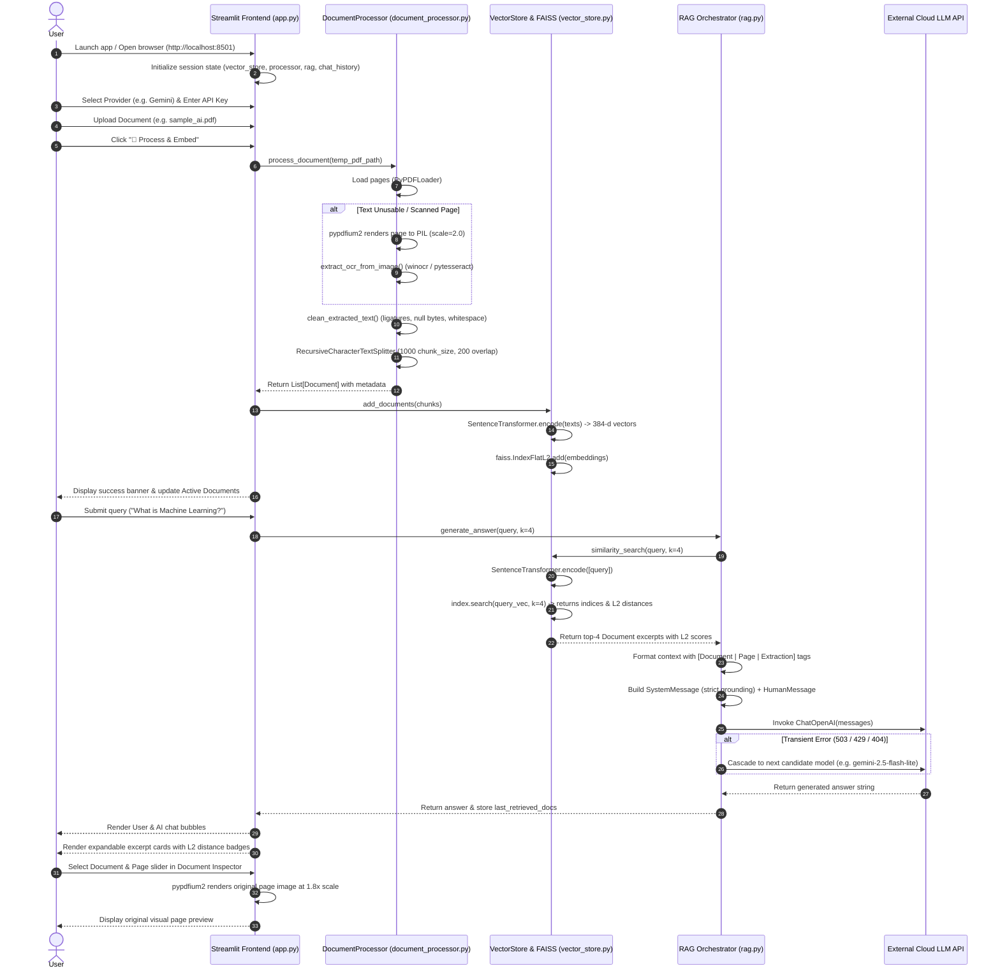

# DocuMind AI: Technical Execution Workflow & RAG Internals

> **Module Reference**: Deep Technical Specification & Pipeline Execution  
> **Source Files**: [`app.py`](file:///c:/Users/Mahan/Downloads/DocuMind_ai-main/DocuMind_ai-main/app.py), [`document_processor.py`](file:///c:/Users/Mahan/Downloads/DocuMind_ai-main/DocuMind_ai-main/document_processor.py), [`vector_store.py`](file:///c:/Users/Mahan/Downloads/DocuMind_ai-main/DocuMind_ai-main/vector_store.py), [`rag.py`](file:///c:/Users/Mahan/Downloads/DocuMind_ai-main/DocuMind_ai-main/rag.py)  

---

## 1. End-to-End Execution Workflow

The complete execution sequence of DocuMind AI spans fifteen discrete stages from system initialization to grounded response rendering.



### Detailed Stage Breakdown

1. **Application Startup**: The user starts Streamlit (`streamlit run app.py`). Streamlit executes `st.set_page_config()` to establish a wide-screen dashboard layout and injects global CSS style rules.
2. **Session Initialization**: In [`app.py:L170-L188`](file:///c:/Users/Mahan/Downloads/DocuMind_ai-main/DocuMind_ai-main/app.py#L170-L188), the engine checks `st.session_state`. If uninitialized, it instantiates the singleton `VectorStore()`, `DocumentProcessor()`, `RAG(vector_store)`, and initializes empty lists for `uploaded_files`, `raw_docs`, and `chat_history`.
3. **Provider Selection & Key Configuration**: In the sidebar, the user selects an AI provider (e.g., `Google Gemini (Free)`). If an API key exists in the environment or `.env`, it is loaded; otherwise, the user pastes a key into a password input box.
4. **Document Ingestion**: The user uploads a file through `st.file_uploader(type=["pdf", "png", "jpg", "jpeg", "webp"])`.
5. **Temporary Staging & Cache**: `process_document(uploaded_file)` saves the stream into `tempfile.NamedTemporaryFile` and caches the raw byte buffer in `st.session_state.raw_docs[filename]`.
6. **Multi-Engine Extraction**:
   - If the file is an image (`.png`, `.jpg`, etc.), [`load_image()`](file:///c:/Users/Mahan/Downloads/DocuMind_ai-main/DocuMind_ai-main/document_processor.py#L219-L248) is invoked directly.
   - If the file is a PDF, [`load_pdf()`](file:///c:/Users/Mahan/Downloads/DocuMind_ai-main/DocuMind_ai-main/document_processor.py#L144-L217) uses `PyPDFLoader`. If `PyPDFLoader` encounters malformed syntax, the loader falls back to `pypdfium2`.
7. **Usability Heuristic & OCR Fallback**: For each page, [`is_text_usable()`](file:///c:/Users/Mahan/Downloads/DocuMind_ai-main/DocuMind_ai-main/document_processor.py#L44-L62) evaluates character counts and font corruption. If alphanumeric characters $< 30$ or font CID glyph matches $> 5$ (dominating $30\%$ of tokens), [`_extract_page_with_pdfium_and_ocr()`](file:///c:/Users/Mahan/Downloads/DocuMind_ai-main/DocuMind_ai-main/document_processor.py#L110-L143) renders the page to an image and runs OCR.
8. **Text Normalization**: [`clean_extracted_text()`](file:///c:/Users/Mahan/Downloads/DocuMind_ai-main/DocuMind_ai-main/document_processor.py#L9-L43) strips null bytes, restores ligatures (`fi` $\rightarrow$ `fi`, etc.), normalizes quotes/dashes, standardizes line breaks, and collapses multiple spaces.
9. **Recursive Character Chunking**: [`chunk_documents()`](file:///c:/Users/Mahan/Downloads/DocuMind_ai-main/DocuMind_ai-main/document_processor.py#L249-L265) segments pages using `RecursiveCharacterTextSplitter` into chunks (default 1,000 characters with 200 character overlap), tagging each chunk with `chunk_index` and `char_count`.
10. **Vector Embedding**: In [`vector_store.py:add_documents()`](file:///c:/Users/Mahan/Downloads/DocuMind_ai-main/DocuMind_ai-main/vector_store.py#L26-L51), text chunks are encoded into 384-dimensional dense vectors using `SentenceTransformer("all-MiniLM-L6-v2")`.
11. **FAISS Indexing**: Embeddings are appended to `faiss.IndexFlatL2` as `float32` arrays, and chunk documents are appended to `self.documents`. The temporary disk file is deleted via `os.unlink()`.
12. **User Query Submission**: The user submits a question in the main chat input.
13. **Semantic Top-$k$ Retrieval**: In [`rag.py:generate_answer()`](file:///c:/Users/Mahan/Downloads/DocuMind_ai-main/DocuMind_ai-main/rag.py#L114-L130), `vector_store.similarity_search(query, k=4)` encodes the query and executes an $L_2$ nearest-neighbor search, attaching the distance score to each chunk's metadata.
14. **Grounded Prompt Construction**: Retrieved passages are assembled into structured blocks with document names, page numbers, and extraction types, then injected into a strict anti-hallucination system prompt.
15. **Inference, Cascading & Rendering**: The LLM synthesizes an evidence-grounded answer (with automatic model cascading if temporary errors occur). Streamlit renders user and assistant chat bubbles, expandable passage inspection cards, and the interactive visual page preview.

---

## 2. Deep Technical Explanation of RAG

Retrieval-Augmented Generation (RAG) is an architectural framework that pairs an information retrieval system with a generative language model. In DocuMind AI, RAG operates as follows:

### 2.1 Why Documents are Processed Before Inquiries
Generative language models do not possess continuous internal learning loops; their weights are frozen after pre-training. To allow an LLM to answer questions about proprietary, enterprise, or newly uploaded documents, the system must provide that context at inference time. However, feeding an entire 100-page document into an LLM's prompt window is prohibitively expensive, introduces high latency, and degrades reasoning accuracy (known as the "lost-in-the-middle" phenomenon). DocuMind AI pre-processes documents into discrete semantic chunks and indexes them mathematically in advance.

### 2.2 Granularity & The Mathematics of Chunking
A document cannot be indexed as a single monolithic block, nor can it be indexed as isolated words.
- **Under-chunking (Too large)**: If a chunk spans 5,000 characters, it may contain multiple unrelated topics, diluting the embedding vector and introducing irrelevant noise into the prompt.
- **Over-chunking (Too small)**: If a chunk is only 50 characters, it lacks the surrounding grammatical context needed to convey a coherent thought.
- **Hierarchical Recursive Splitting**: DocuMind AI configures `chunk_size=1000` and `chunk_overlap=200` with separators `["\n\n", "\n", ". ", "? ", "! ", "; ", " ", ""]`. The overlap ensures that sentences crossing a chunk boundary are not split mid-thought, preserving contextual continuity.

### 2.3 Semantic Vector Space
Natural language tokens are converted into dense mathematical coordinates via `all-MiniLM-L6-v2`. Rather than matching strings lexically, the transformer projects semantic meaning into $\mathbb{R}^{384}$. Concepts with similar contextual meaning occupy proximate geometric locations in vector space:

$$\text{Distance}(\vec{v}_{\text{diagnosis}}, \vec{v}_{\text{clinical identification}}) \ll \text{Distance}(\vec{v}_{\text{diagnosis}}, \vec{v}_{\text{aerospace propulsion}})$$

### 2.4 Similarity Metrics: Euclidean Distance ($L_2$) vs. Cosine Similarity
DocuMind AI utilizes `faiss.IndexFlatL2`. Given query embedding $\mathbf{q}$ and document chunk embedding $\mathbf{d}$:

$$L_2(\mathbf{q}, \mathbf{d}) = \sqrt{\sum_{i=1}^{384} (q_i - d_i)^2}$$

Because `all-MiniLM-L6-v2` produces normalized unit vectors ($\|\mathbf{q}\|_2 = \|\mathbf{d}\|_2 = 1$), Euclidean distance is monotonically related to Cosine Similarity:

$$L_2^2(\mathbf{q}, \mathbf{d}) = \|\mathbf{q}\|_2^2 + \|\mathbf{d}\|_2^2 - 2(\mathbf{q} \cdot \mathbf{d}) = 2 - 2 \cos(\theta)$$

Thus, minimizing $L_2$ distance is mathematically equivalent to maximizing Cosine Similarity, but executes with hardware-accelerated SIMD instructions inside FAISS. A lower $L_2$ score indicates higher relevance (e.g., $0.25$ indicates an exact semantic match, while $1.4$ indicates divergence).

### 2.5 Illustrative Execution Walkthrough

> *Notice: The following trace illustrates system behavior using sample queries and documents.*

#### Example Setup
- **Document**: `sample_ai.pdf` (Page 2)
- **Document Content**:
  > *"Machine Learning is a subset of AI that focuses on developing systems that can learn and improve from experience without being explicitly programmed. Deep Learning, a subset of Machine Learning, uses artificial neural networks to learn from large amounts of data."*
- **User Query**: *"How does deep learning acquire knowledge?"*

#### Step 1: Query Vectorization
The query is transformed into a 384-dimensional vector:
$$\mathbf{q} = \text{SentenceTransformer.encode}("How\ does\ deep\ learning\ acquire\ knowledge?") \in \mathbb{R}^{384}$$

#### Step 2: FAISS Index Search
FAISS scans the chunk vectors and identifies Chunk #2 as the nearest neighbor with an $L_2$ distance of $0.412$.

#### Step 3: Context Formatting
The retrieved chunk is formatted into the system prompt:
```text
DOCUMENT EXCERPTS:
[Document: sample_ai.pdf | Page: 2 | Extraction: native]
Machine Learning is a subset of AI that focuses on developing systems that can learn and improve from experience without being explicitly programmed. Deep Learning, a subset of Machine Learning, uses artificial neural networks to learn from large amounts of data.
```

#### Step 4: Grounded Synthesis
The model generates the verified response:
> *"Deep Learning acquires knowledge by utilizing artificial neural networks that learn patterns from large quantities of data [Page 2]."*

#### Step 5: Handling Unanswerable Inquiries
If the user asks: *"What is the capital of France?"*, FAISS returns excerpts about artificial intelligence with high $L_2$ distances ($> 1.25$). The prompt instructions trigger the refusal logic:
> *"Based on the provided document excerpts, this information cannot be found. The uploaded document discusses Artificial Intelligence, Machine Learning, Deep Learning, and their applications in healthcare, finance, transportation, and entertainment."*

---

## 3. Deep Dive: Document Processing & OCR Architecture

### 3.1 Text Normalization Pipeline
The [`clean_extracted_text()`](file:///c:/Users/Mahan/Downloads/DocuMind_ai-main/DocuMind_ai-main/document_processor.py#L9-L43) function executes several cleaning steps:
- **Null Byte Elimination**: Removes `\x00` characters that cause C-string crashes in downstream tokenizers.
- **Replacement Character Filtering**: Removes `\uFFFD`, which appears when character decoding fails.
- **Typographic Ligature Expansion**: Restores composite characters generated by PDF typesetting engines (e.g., LaTeX, InDesign) into standard ASCII character sequences:
  - `fi` $\rightarrow$ `fi`
  - `fl` $\rightarrow$ `fl`
  - `ff` $\rightarrow$ `ff`
  - `ffi` $\rightarrow$ `ffi`
  - `ffl` $\rightarrow$ `ffl`
- **Quote and Dash Normalization**: Converts curly quotes (`’`, `‘`, `“`, `”`) to standard single and double quotes, and em/en dashes (`–`, `—`) to standard hyphens.
- **Whitespace Collapsing**: Converts non-breaking spaces (`\xa0`) to regular spaces, removes zero-width spaces (`\u200b`), standardizes line endings to `\n`, collapses 3+ consecutive newlines to 2, and collapses repeated horizontal tabs and spaces into single spaces.

### 3.2 Usability Heuristic (`is_text_usable`)
PDF parsers often extract non-empty strings that contain no readable text (e.g., copyright footers, invisible watermarks, or corrupted font tables). In [`document_processor.py:L44-L62`](file:///c:/Users/Mahan/Downloads/DocuMind_ai-main/DocuMind_ai-main/document_processor.py#L44-L62), `is_text_usable` applies two checks:
1. **Alphanumeric Threshold**: Requires at least 30 alphanumeric characters (`sum(1 for ch in text if ch.isalnum()) >= 30`).
2. **Font Encoding Integrity**: Checks for raw glyph identifiers like `(cid:12)`. If more than 5 CID matches are found and they represent more than 30% of total tokens, the digital text layer is flagged as corrupted.

### 3.3 Multi-Engine OCR Fallback
When a page fails the usability check:
1. `pypdfium2` loads the PDF page and renders it at `scale=2.0` (300+ DPI equivalent) to a PIL Image.
2. In [`extract_ocr_from_image()`](file:///c:/Users/Mahan/Downloads/DocuMind_ai-main/DocuMind_ai-main/document_processor.py#L63-L88):
   - **Primary Engine**: Native Windows OCR (`winocr.recognize_pil_sync(image)`). Fast, hardware-accelerated, and runs without installing external binaries on Windows.
   - **Secondary Engine**: `pytesseract.image_to_string(image)` as a cross-platform fallback when running on Linux or macOS.
   - **Clean & Return**: Extracted OCR text is passed through `clean_extracted_text()` and returned with metadata `extraction_method="ocr"` and `ocr_applied=True`.

---

## 4. Multi-Provider LLM Integration & Cascading Fallback

In [`rag.py`](file:///c:/Users/Mahan/Downloads/DocuMind_ai-main/DocuMind_ai-main/rag.py), the `RAG` class manages model interactions across multiple providers through an OpenAI-compatible REST interface (`langchain_openai.ChatOpenAI`):

```python
PROVIDER_CONFIGS = {
    "Google Gemini (Free)": {
        "base_url": "https://generativelanguage.googleapis.com/v1beta/openai/",
        "model": "gemini-2.0-flash",
        "env_var": "GEMINI_API_KEY",
        "doc_url": "https://aistudio.google.com/app/apikey"
    },
    "Groq (Free)": {
        "base_url": "https://api.groq.com/openai/v1",
        "model": "llama-3.3-70b-versatile",
        "env_var": "GROQ_API_KEY",
        "doc_url": "https://console.groq.com/keys"
    },
    "OpenRouter (Free Tier)": {
        "base_url": "https://openrouter.ai/api/v1",
        "model": "meta-llama/llama-3.3-70b-instruct:free",
        "env_var": "OPENROUTER_API_KEY",
        "doc_url": "https://openrouter.ai/keys"
    },
    "OpenAI": {
        "base_url": None,
        "model": "gpt-3.5-turbo",
        "env_var": "OPENAI_API_KEY",
        "doc_url": "https://platform.openai.com/api-keys"
    }
}
```

### Cascading Retry Mechanism
During peak traffic hours, free-tier endpoints may return transient errors: HTTP 503 (service unavailable / high demand), 429 (rate limit exceeded), or 404 (model deprecated).

When an error occurs, [`rag.py:L197-L225`](file:///c:/Users/Mahan/Downloads/DocuMind_ai-main/DocuMind_ai-main/rag.py#L197-L225) detects retryable error codes (`503`, `429`, `404`, `"high demand"`, `"resource_exhausted"`, `"overloaded"`) and cascades across configured fallback candidates:
- **Google Gemini Candidates**: `gemini-2.0-flash` $\rightarrow$ `gemini-2.5-flash-lite` $\rightarrow$ `gemini-2.0-flash-lite` $\rightarrow$ `gemini-2.5-flash` $\rightarrow$ `gemini-3.8-flash`.
- **Groq Candidates**: `llama-3.3-70b-versatile` $\rightarrow$ `llama-3.1-8b-instant`.

For non-retryable errors (e.g., invalid API keys or exhausted account quotas), the engine catches the exception immediately and presents a clear, actionable notification in the user interface.

---

## 5. Codebase Module-by-Module Walkthrough

```bash
DocuMind_ai-main/
├── app.py                   # Streamlit web UI and session orchestration
├── document_processor.py    # Multi-engine document parsing, OCR, and chunking
├── vector_store.py          # SentenceTransformers and FAISS vector index
├── rag.py                   # RAG logic, prompt engineering, and LLM cascading
├── conftest.py              # Pytest fixtures and mock objects
├── create_sample.py         # Utility script to generate sample test PDFs
├── setup.py                 # Package setup and metadata
├── Dockerfile               # Production Docker container definition
├── requirements.txt         # Core dependencies
├── requirements-dev.txt     # Test and linting dependencies
└── tests/                   # Automated test suite (19 test cases)
    ├── test_app.py
    ├── test_document_processor.py
    ├── test_rag.py
    └── test_vector_store.py
```

### Module Responsibilities

| File | Primary Functions / Classes | Inputs | Outputs | Dependencies |
| :--- | :--- | :--- | :--- | :--- |
| [`app.py`](file:///c:/Users/Mahan/Downloads/DocuMind_ai-main/DocuMind_ai-main/app.py) | `process_document()`, `clear_documents()`, Streamlit UI components | Uploaded file streams, user queries, sidebar configuration | Rendered web UI, session state updates | `streamlit`, `document_processor`, `vector_store`, `rag`, `pypdfium2`, `PIL` |
| [`document_processor.py`](file:///c:/Users/Mahan/Downloads/DocuMind_ai-main/DocuMind_ai-main/document_processor.py) | `DocumentProcessor`, `clean_extracted_text()`, `is_text_usable()`, `extract_ocr_from_image()` | File paths (PDF, images), raw image buffers | List of LangChain `Document` objects with rich metadata | `pypdf`, `pypdfium2`, `PIL`, `langchain`, `winocr`, `pytesseract` |
| [`vector_store.py`](file:///c:/Users/Mahan/Downloads/DocuMind_ai-main/DocuMind_ai-main/vector_store.py) | `VectorStore`, `add_documents()`, `similarity_search()`, `save_index()`, `load_index()` | `Document` chunk lists, string queries | Top-$k$ retrieved `Document` objects with L2 scores | `faiss`, `sentence_transformers`, `numpy` |
| [`rag.py`](file:///c:/Users/Mahan/Downloads/DocuMind_ai-main/DocuMind_ai-main/rag.py) | `RAG`, `configure_llm()`, `set_api_key()`, `generate_answer()` | String queries, `VectorStore` instance, API credentials | Grounded answer string, cited source document list | `langchain_openai`, `dotenv` |

---

*Continue to detailed technical guides:*
- [Comprehensive Project Description](file:///c:/Users/Mahan/Downloads/DocuMind_ai-main/DocuMind_ai-main/docs/PROJECT_DESCRIPTION.md)
- [System Architecture & Component Interactions](file:///c:/Users/Mahan/Downloads/DocuMind_ai-main/DocuMind_ai-main/docs/ARCHITECTURE.md)
- [Deployment, Docker & Security Guide](file:///c:/Users/Mahan/Downloads/DocuMind_ai-main/DocuMind_ai-main/docs/DEPLOYMENT.md)
- [Interview & Viva Voce Preparation Guide](file:///c:/Users/Mahan/Downloads/DocuMind_ai-main/DocuMind_ai-main/docs/INTERVIEW_PREPARATION.md)
